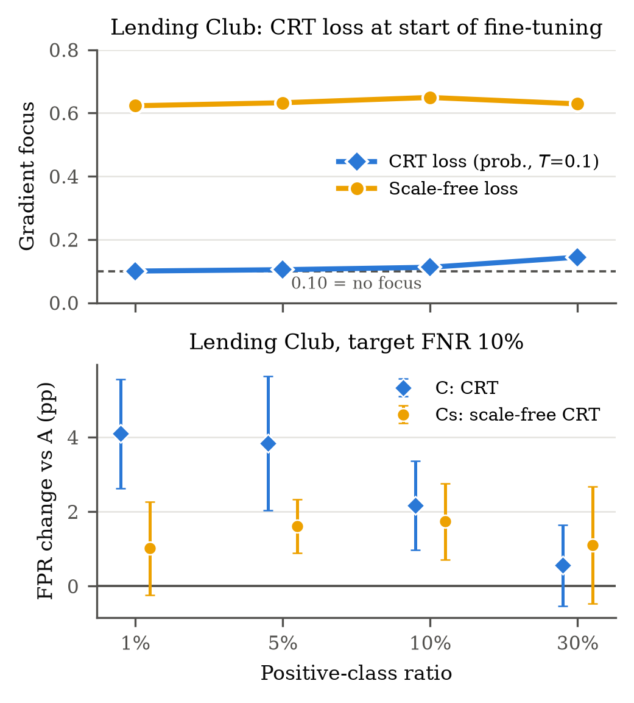
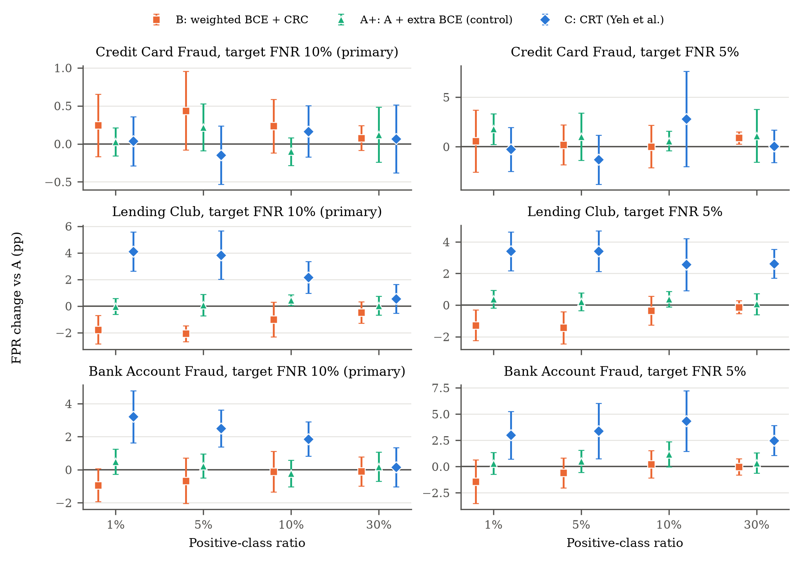
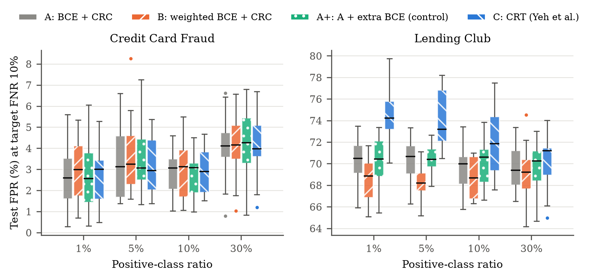
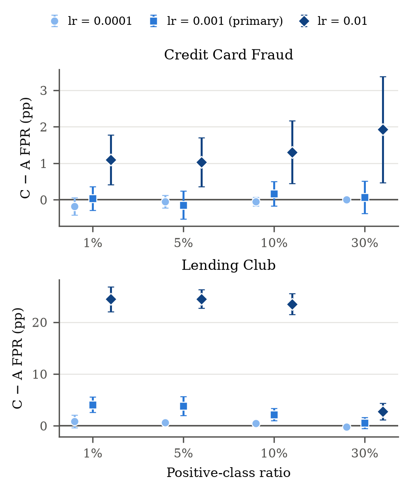

# ImbalanceCRT: Conformal Risk Training Under Class Imbalance

**Why does Conformal Risk Training (CRT; Yeh et al., NeurIPS 2025) lose to post-hoc conformal risk
control on imbalanced tabular data, and can it be fixed?**

Conformal risk control (CRC) picks a decision threshold *after* training so that a model's
expected false-negative rate (FNR) stays below a target. CRT instead trains the model *through*
that threshold, and was reported to lower false positives on image segmentation. This project
tests whether that advantage carries over to imbalanced tabular binary classification:

> At a matched target FNR, does CRT's false-positive-rate (FPR) advantage over post-hoc CRC
> **hold, shrink, or reverse** as the positive-class ratio drops from 30% to 1%?

and then asks **why** the answer is what it is.

The project has two stages:

- **Stress test (protocol v2):** CRT used as in the
  [official implementation](https://github.com/chrisyeh96/conformal-risk-training), with four
  documented protocol deviations (below).
- **Diagnosis and fix (protocol v3):** a diagnostic of CRT's loss, a modified CRT with a
  scale-free temperature, and an experiment varying the number of positives. The v3 model
  modifies CRT and is labelled separately (**Cs**).

This is an extension and stress test of an existing method, not a new state-of-the-art method.

---

## Key findings

All results: 10 seeds × 100 paired calibration/test re-splits, target FNR 10% (primary).
"pp" = percentage points of FPR; positive = more false alarms than post-hoc CRC (model A).

**1. The reported advantage does not transfer (v2).**

| Dataset | Positive ratio | FPR change, CRT − post-hoc CRC (95% CI) |
|---|---|---|
| Credit Card Fraud | 1% / 5% / 10% / 30% | +0.03 / −0.15 / +0.16 / +0.07 pp, **all CIs within ±0.53 pp** |
| Lending Club | 1% | **+4.09 pp** [2.62, 5.56] |
| Lending Club | 5% | **+3.84 pp** [2.03, 5.64] |
| Lending Club | 10% | **+2.17 pp** [0.98, 3.36] |
| Lending Club | 30% | +0.56 pp [−0.53, 1.64], not significant |
| Bank Account Fraud (synthetic) | 1% / 5% / 10% | **+3.21 / +2.51 / +1.86 pp** (Holm p ≤ 0.012) |
| Bank Account Fraud (synthetic) | 30% | +0.15 pp [−1.04, 1.34], not significant |

CRT is neutral on fraud and *increases* false positives on Lending Club and Bank Account Fraud, more
so as positives get rarer, at every fine-tuning learning rate tried and under Yeh et al.'s validation-based selection.
Post-hoc CRC met the FNR target within sampling noise for every model. Simple class weighting
helped on Lending Club at 1% and 5% positives (−1.8 and −2.1 pp).

**2. Why: CRT's smooth FPR loss collapses at low base rates (v3, Experiment 0).**
CRT replaces the false-positive count with mean σ((p − λ)/T), using probabilities and T = 0.1.
On Lending Club at 1% positives the threshold λ is about 0.005, inside the bulk of the negatives'
probabilities, so the sigmoid is about 0.5 for almost every negative. The loss then pushes all
negatives about equally instead of the ones near the threshold:

| Lending Club ratio | 1% | 5% | 10% | 30% |
|---|---|---|---|---|
| λ (probability) | 0.005 | 0.027 | 0.052 | 0.164 |
| Real FPR / CRT's smooth FPR | 0.65 / 0.51 | 0.64 / 0.55 | 0.66 / 0.59 | 0.68 / 0.65 |
| Gradient focus on the 10% of negatives nearest λ (0.10 = none) | **0.100** | 0.105 | 0.112 | 0.144 |
| CRT − CRC (from finding 1) | +4.09 | +3.84 | +2.17 | +0.56 |

The collapse worsens in the same order as CRT's harm (Model A, FIT data, seeds 0–2; descriptive).

**3. A scale-free temperature removes the imbalance-dependent harm on Lending Club, but is not a
general improvement (v3, Experiment 1).** Model **Cs** computes CRT on logits with
T = 0.1 × std(the step's negative logits); everything else matches CRT.

| Dataset, ratio | 1% | 5% | 10% | 30% |
|---|---|---|---|---|
| Lending Club, Cs − CRC | +1.02 (n.s.) | **+1.61** | **+1.74** | +1.10 (n.s.) |
| Lending Club, Cs − CRT | **−3.07** [−4.86, −1.28], 10/10 seeds | −2.23 (n.s. after Holm) | −0.43 (n.s.) | +0.55 (n.s.) |
| Fraud, Cs − CRC | +0.41 (n.s.) | +0.72 (n.s.) | **+0.54** | −0.14 (n.s.) |

On Lending Club the harm no longer grows with imbalance, but a residual of about 1–2 pp remains.
On fraud the sharper loss is slightly harmful at a 10% target and clearly harmful at a 5% target
(+4.6 to +7.4 pp at 1–10%). Neither version of CRT beats post-hoc CRC.
<p align="center"></p>

*Lending Club. Top: share of the CRT loss's gradient on the 10% of negatives nearest the threshold
(0.10 = every negative pushed equally), at the start of fine-tuning. Bottom: paired FPR change vs
model A for original CRT (C) and scale-free CRT (Cs) at target FNR 10% (mean and 95% CI, 10 seeds).*

**4. The imbalance effect follows the positive *ratio*, not the positive *count* (v3, Experiment 3).**
Repeating Lending Club with 500, 1,500 and 5,000 defaults per seed:

| Mean CRT harm over ratios (pp) | 500 | 1,500 | 5,000 | 500 vs 5,000 |
|---|---|---|---|---|
| CRT (C) − CRC | +2.49 | +2.66 | +2.27 | Welch p = 0.71 |
| Cs − CRC | +1.55 | +1.37 | +0.97 | Welch p = 0.15 |

The residual harm does not shrink significantly with ten times more positives, so it is not
explained by overfitting a small positive set. CRT's harm stays largest at 1% and smallest at 30%
at every count (1%: +4.8 / +4.1 / +3.6 pp), consistent with the base-rate collapse in finding 2.

**5. The diagnosis predicted where CRT would fail on a third dataset.** On Bank Account Fraud
(a synthetic NeurIPS 2022 benchmark of intermediate difficulty), the diagnostic was run first and the
prediction fixed before any CRT model was trained: harm where the gradient focus is ≤ 0.115.

| Bank Account Fraud ratio | 1% | 5% | 10% | 30% |
|---|---|---|---|---|
| Gradient focus of CRT's loss | 0.101 | 0.107 | 0.113 | 0.152 |
| Predicted harm? | yes | yes | yes | no |
| CRT − CRC (pp) | **+3.21** | **+2.51** | **+1.86** | +0.15 (n.s.) |
| Cs − CRT (pp) | −1.38 (n.s.) | −0.90 (n.s.) | +0.01 | +0.75 (n.s.) |

The harm appeared at exactly the predicted ratios. The scale-free fix pointed the right way at 1% and
5% but not significantly, and, as on Lending Club, a residual harm of about 1–2 pp remained.



*Paired change in test FPR relative to model A (mean and 95% CI over 10 seeds). Below zero = fewer
false positives than A. Rows: credit card fraud, Lending Club, Bank Account Fraud.*

<table>
<tr>
<td width="50%"></td>
<td width="50%"></td>
</tr>
<tr>
<td><em>Test FPR at target FNR 10% for each model and positive-class ratio (v2, 10 seeds). On Lending Club,
CRT (blue) sits above the others at 1&ndash;10% positives.</em></td>
<td><em>FPR change of CRT relative to model A at each fine-tuning learning rate (target FNR 10%).
On Lending Club the increase grows with the learning rate and is smallest at 30% positives.</em></td>
</tr>
</table>

Full statistics: [`results/stats_paired.csv`](results/stats_paired.csv) (v2),
[`results/stats_v3.csv`](results/stats_v3.csv) (Experiment 1),
[`results/stats_npos.csv`](results/stats_npos.csv) (Experiment 3).

---

## What is compared

All models share one MLP (hidden layers 64 and 32, ReLU), trained with Adam (lr 10⁻³, batch 256),
and every model's threshold is set by the same post-hoc CRC step.

| Model | Training | Stage |
|---|---|---|
| **A** | Binary cross-entropy, early stopping on validation loss | v2 |
| **B** | Class-weighted cross-entropy (weight = n_neg / n_pos), trained from scratch, early stopping | v2 |
| **C** | Model A fine-tuned with **CRT** (probabilities, T = 0.1; one model per target FNR) | v2 |
| **A+** | Model A fine-tuned with plain cross-entropy for the same budget (control) | v2 |
| **Cs** | Model A fine-tuned with CRT on **logits**, T = 0.1 × std of the step's negative logits (detached) | v3 |

A+ exists so that any gain of C cannot be explained by extra training. Cs differs from C only in
the score space and the temperature.

**Datasets**

| | Credit Card Fraud (ULB) | Lending Club | Bank Account Fraud (BAF) |
|---|---|---|---|
| Source | kagglehub `mlg-ulb/creditcardfraud` | kagglehub `wordsforthewise/lending-club` | kagglehub `sgpjesus/bank-account-fraud-dataset-neurips-2022` (Base.csv) |
| Type | real | real | **synthetic**, generated from a real bank dataset |
| Rows used | 284,807 transactions | 1,345,350 resolved loans (Fully Paid vs Charged Off / Default) | 1,000,000 account applications (1.10% fraud) |
| Positives kept per ratio | all 492 frauds | 1,500 defaults per seed (500 and 5,000 in Experiment 3) | 1,500 frauds per seed |
| Features | 30 (28 PCA + time + amount) | 50 (only columns known at loan issue; no leakage) | 51 (month dropped; missing codes → train median) |
| Train / cal / test positives | 246 / 148 / 98 | 750 / 450 / 300 (at 1,500 defaults) | 750 / 450 / 300 |

**Protocol**

- Imbalance sweep: negatives subsampled so positives are **30%, 10%, 5%, 1%** of the data.
- Splits: stratified 50 / 30 / 20 (train / calibration / test); 20% of train held out for validation.
- Target FNR α ∈ {0.05, 0.10}; **α = 0.10 is primary**.
- CRC is applied on logits; each trained model is evaluated on **100 random calibration/test
  re-splits**, identical across models for a given seed (paired).
- Statistics: paired differences vs A, t-based 95% CIs, Wilcoxon signed-rank tests,
  Holm correction over the four ratios. Experiment 3 compares different data samples, so it uses
  a Welch t-test on per-seed means.
- **v2 primary:** C and A+ fine-tuned at lr 10⁻³ (fixed before the final runs). **Sensitivity:**
  lr 10⁻⁴ and 10⁻², and Yeh-style selection by validation metric.
- **v3 (fixed before each run):** Experiment 0 uses training data only. Experiment 1 primary:
  Cs with scale 0.1 at lr 10⁻³; scales 0.05 and 0.2 as sensitivity; success criterion: on Lending
  Club at 1/5/10%, Cs not significantly worse than A *and* significantly better than C (**not met**).
  Experiment 3 primary: Welch test of the mean harm at 500 vs 5,000 defaults.

**Deviations from the official CRT protocol** (also stated in the paper and in `src/train_crt.py`)

1. Each CRT step uses a fixed number of positives (a random half of the training positives) as the
   pseudo-calibration set, plus 256 sampled negatives for the loss; random batches at 1% positives
   contain too few positives for CRC to be feasible.
2. Early stopping and learning-rate choice use a validation split from the training data, not the
   calibration set, so calibration and test data are never seen in training.
3. Learning-rate grid {10⁻⁴, 10⁻³, 10⁻²} instead of 10⁻⁶–10⁻², for CPU cost.
4. A fixed 20 optimization steps per fine-tuning epoch at every ratio.

---

## Repository layout

```
ImbalanceCRT/
├── src/
│   ├── config.py              # all settings: ratios, alphas, seeds, splits, training and CRT hyperparameters
│   ├── data.py                # download, cleaning, imbalance sweep, train-only imputation/scaling
│   ├── models.py              # the MLP and logit scoring
│   ├── crc.py                 # post-hoc CRC for FNR, FNR/FPR metrics, oracle FPR
│   ├── baselines.py           # Model A/B training and the shared re-split evaluation
│   ├── train_crt.py           # v2: A, B, A+ and C (CRT) for one dataset
│   ├── analyze.py             # v2: paired statistics, LaTeX table and figures
│   ├── diagnose_surrogate.py  # v3 Exp 0: does CRT's smooth FPR track the real FPR?
│   ├── train_crt_v3.py        # v3 Exp 1: A and Cs (scale-free temperature)
│   ├── analyze_v3.py          # v3 Exp 1: Cs vs A and vs C, success criterion
│   ├── train_npos.py          # v3 Exp 3: A, C, Cs on Lending Club with 500 / 5,000 defaults
│   └── analyze_npos.py        # v3 Exp 3: harm vs number of positives
├── results/
│   ├── fraud_crt_v2.csv, lending_club_crt_v2.csv, baf_crt_v2.csv   # v2 main results
│   ├── stats_paired.csv, tables/, figures/           # v2 statistics, table, figures
│   ├── *_surrogate_diag.csv                          # Exp 0
│   ├── *_crt_v3.csv, stats_v3.csv                    # Exp 1
│   ├── lending_club_ceiling_check.csv                # gradient-boosted trees vs MLP (descriptive)
│   ├── lending_club_npos{500,5000}.csv, stats_npos.csv   # Exp 3
│   └── fraud_baselines*.csv, fraud_crt.csv           # earlier runs, kept for the record (see below)
├── requirements.txt
└── README.md
```

---

## Reproducing the results

Everything runs on a CPU; no GPU is needed. Tested with Python 3.12 on Windows.

**1. Set up**

```bash
git clone https://github.com/Soumya-205/ImbalanceCRT.git
cd ImbalanceCRT
python -m venv venv
# Windows (PowerShell):  .\venv\Scripts\Activate.ps1
# macOS / Linux:         source venv/bin/activate
pip install -r requirements.txt
```

**2. Check the data pipeline** (downloads the datasets through `kagglehub` on first run;
Lending Club is about 1.3 GB and is cached as `data/lending_club_clean.pkl` after cleaning)

```bash
python src/data.py
python src/data.py --dataset lending_club
```

**3. Stress test (v2)** (each sweep: 4 ratios × 10 seeds; Lending Club takes longest)

```bash
python src/train_crt.py --quick                          # smoke test: fraud, 1 seed, 5% ratio
python src/train_crt.py                                  # -> results/fraud_crt_v2.csv
python src/train_crt.py --dataset lending_club           # -> results/lending_club_crt_v2.csv
python src/analyze.py                                    # stats, table, figures
```

**4. Diagnosis and fix (v3)** (needs the v2 CSVs for the comparisons)

```bash
python src/diagnose_surrogate.py                         # Exp 0, fraud (seeds 0-2)
python src/diagnose_surrogate.py --dataset lending_club  # Exp 0, Lending Club
python src/train_crt_v3.py                               # Exp 1 -> results/fraud_crt_v3.csv
python src/train_crt_v3.py --dataset lending_club        # Exp 1 -> results/lending_club_crt_v3.csv
python src/analyze_v3.py                                 # Exp 1 statistics
python src/train_npos.py --n_pos 500                     # Exp 3
python src/train_npos.py --n_pos 5000
python src/analyze_npos.py                               # Exp 3 statistics
```

**5. Third dataset (Bank Account Fraud)**

```bash
python src/data.py --dataset baf
python src/diagnose_surrogate.py --dataset baf           # run first: fixes the prediction
python src/train_crt.py --dataset baf                    # -> results/baf_crt_v2.csv
python src/train_crt_v3.py --dataset baf                 # -> results/baf_crt_v3.csv
python src/analyze.py && python src/analyze_v3.py
```

Running the analysis scripts on the CSVs in this repository reproduces the numbers above.
All settings live in `src/config.py`.

---

## Earlier runs

The repository also keeps earlier fraud-only results for transparency:

- `fraud_baselines_single_split.csv`, `fraud_baselines.csv`: Models A and B before the re-split
  evaluation and early stopping were introduced (`src/baselines.py`).
- `fraud_crt.csv` (v1): the first CRT run. It selected the fine-tuning learning rate on a small
  validation set (which mostly chose 10⁻², the worst rate on test data) and trained A for a fixed
  30 epochs (only 90 gradient steps at the 30% level). The protocol was revised to fix both
  issues before the final v2 runs; v1 is not used for conclusions.

---

## Limitations

- One architecture (a small MLP) and three datasets; the third (Bank Account Fraud) is synthetic and
  was added after the diagnosis, although its prediction was fixed before any CRT model was trained.
- Positives are fixed and negatives vary, so imbalance is partly confounded with training-set size;
  Experiment 3 varies the number of positives at a fixed ratio, but the number of negatives still
  changes with it.
- Few positives on fraud (98 test, 148 calibration), so α = 0.05 comparisons have low power.
- Fraud duplicates are retained; Lending Club uses resolved loans only; splits are random, not temporal.
- The diagnostic (Experiment 0) is descriptive, measured at the start of fine-tuning on 3 seeds;
  its gradient-focus measure is taken in the loss's own score space.
- The scale-free temperature was chosen from the training-data diagnostic, with one primary value;
  it removes the imbalance-dependent harm on Lending Club but hurts on fraud.
- A residual harm of about 1–2 pp for both CRT versions on Lending Club is not explained by the
  experiments here.

---

## References

- C. Yeh, N. Christianson, A. Wierman, Y. Yue. *Conformal Risk Training: End-to-End Optimization of
  Conformal Risk Control.* NeurIPS 2025. [arXiv:2510.08748](https://arxiv.org/abs/2510.08748) ·
  [code](https://github.com/chrisyeh96/conformal-risk-training)
- A. N. Angelopoulos, S. Bates, A. Fisch, L. Lei, T. Schuster. *Conformal Risk Control.* ICLR 2024.
  [arXiv:2208.02814](https://arxiv.org/abs/2208.02814)
- A. Dal Pozzolo, O. Caelen, R. A. Johnson, G. Bontempi. *Calibrating Probability with
  Undersampling for Unbalanced Classification.* IEEE SSCI 2015 (credit card fraud dataset).

- S. Jesus, J. Pombal, D. Alves, A. Cruz, P. Saleiro, R. P. Ribeiro, J. Gama, P. Bizarro. *Turning the
  Tables: Biased, Imbalanced, Dynamic Tabular Datasets for ML Evaluation.* NeurIPS 2022 Datasets and
  Benchmarks. [arXiv:2211.13358](https://arxiv.org/abs/2211.13358) (Bank Account Fraud dataset)

## Citation

If you use this code or results, please cite:

```bibtex
@misc{shradha2026imbalancecrt,
  author = {Shradha, Soumya},
  title  = {Conformal Risk Training Under Class Imbalance: Diagnosis and a Scale-Free Temperature},
  year   = {2026},
  howpublished = {\url{https://github.com/Soumya-205/ImbalanceCRT}}
}
```

## Author

**Soumya Shradha**, Department of Computer Science and Engineering, Manipal University Jaipur ·
[GitHub](https://github.com/Soumya-205)